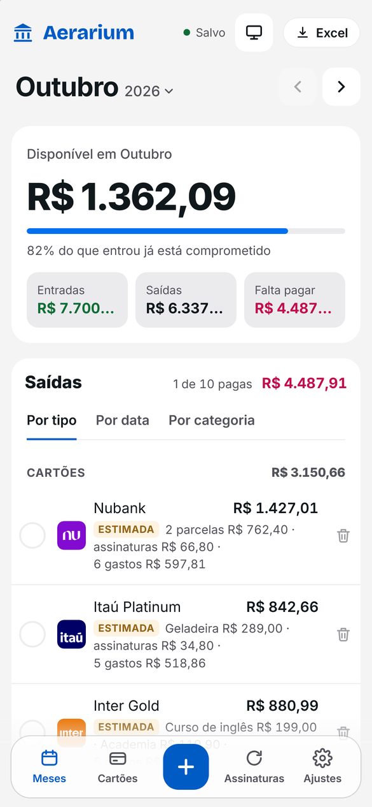
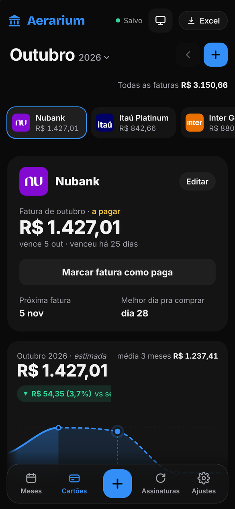
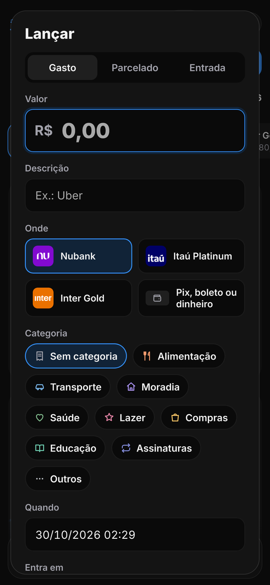
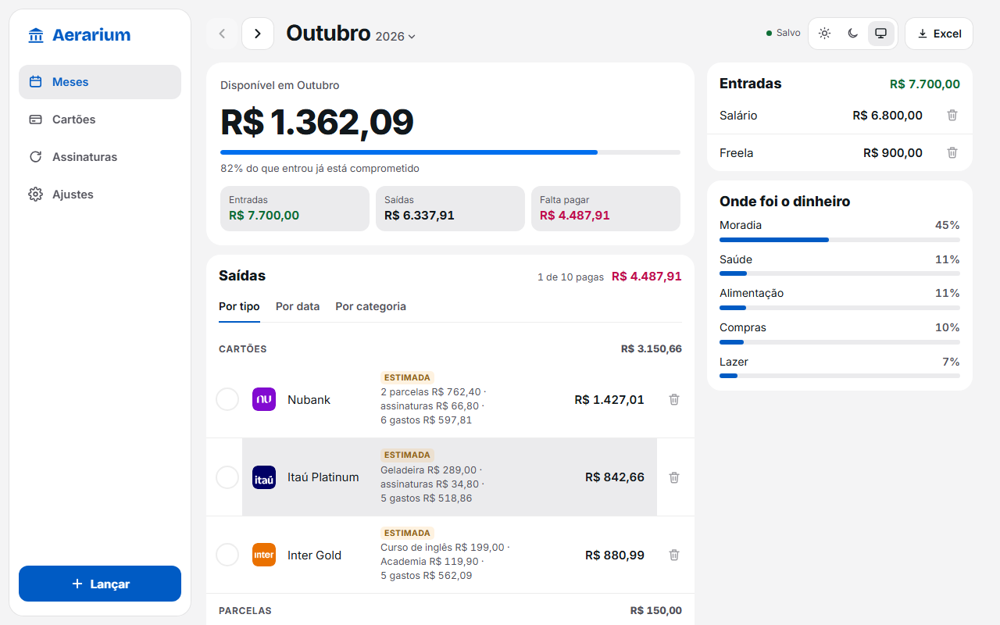
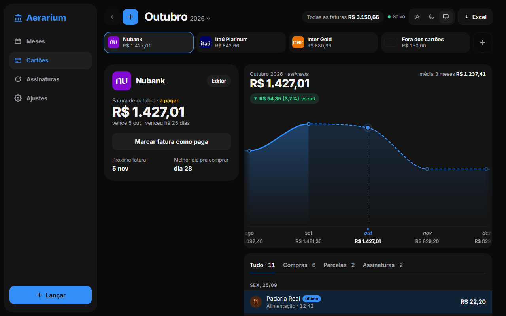

# Aerarium

App pessoal de finanças, mês a mês, feito pra usar no celular. Mostra quanto sobra no mês, controla as faturas de cada cartão e divide os gastos do cartão com outra pessoa.

_Personal finance PWA (React 19 + TypeScript + Supabase), in Brazilian Portuguese. Built and used daily on an iPhone._

**No ar:** https://aerarium-delta.vercel.app

<p>
  
  
  
</p>
<p>
  
  
</p>

Os prints usam uma conta de demonstração, com dados inventados.

## O que o app faz

- **Mês a mês:** entradas, contas, faturas, parcelas e assinaturas. Mostra o disponível, o que falta pagar e quanto do que entrou já está comprometido. Um mês novo começa sozinho, copiando o que se repete.
- **Cartões:** a fatura de cada mês, com o dia de fechamento e o vencimento. Uma compra feita no dia do fechamento ou depois já vai pra fatura seguinte. Tem um gráfico da fatura por mês, com a previsão dos próximos.
- **Lançar:** gasto, parcelado ou entrada, num só lugar, com categoria e cartão.
- **Outra pessoa no cartão:** marca o que é de quem. Quando a fatura fecha, a parte da outra pessoa é o total do banco menos a sua. Ela pode ter a própria conta e ver só o que deve.
- **Open Finance (Pluggy):** o total da fatura fechada chega sozinho do banco, com um aviso no app e um e-mail diário às 18h.
- **Extras:** PWA instalável no iPhone, tema claro e escuro e exportação pra Excel.

## Tecnologias

- **Front:** React 19, TypeScript, Vite, React Router, TanStack Query, HeroUI v3 com Tailwind CSS 4 e vite-plugin-pwa.
- **Back:** Supabase (Postgres com RLS, views, triggers, Edge Functions em Deno e pg_cron). A integração bancária usa a Pluggy e o e-mail usa o Resend.
- **Publicação:** Vercel (front) e Supabase com dois ambientes, desenvolvimento e produção.
- **Testes:** Vitest (mais de 500 testes), Playwright (WebKit no tamanho do iPhone e Chromium no computador, nos dois temas, mais o build de produção) e testes de SQL com rollback.

## Decisões de projeto

- **Dinheiro sempre em centavos inteiros.** Nada de ponto flutuante nas contas.
- **Regras de negócio puras em `src/domain`,** com 100% de cobertura de testes. As views do banco fazem as mesmas contas, e um script (`npm run db:domain`) confere se as duas dão o mesmo resultado.
- **Segurança no banco:** RLS em todas as tabelas, chaves estrangeiras compostas com `user_id` e só a chave pública no front. Os segredos ficam nas Edge Functions.
- **Interface otimista:** as mudanças aparecem na hora e são gravadas em fila. Se a gravação falha, a tela volta atrás e avisa.
- **Celular primeiro:** toda tela é conferida em 390×844 e em 1280×800.

## Estrutura

```
src/
  domain/     regras de negócio puras (meses, faturas, parcelas, Open Finance)
  data/       acesso ao Supabase, cache e operações
  features/   telas (meses, cartões, lançar, banco, assinaturas, ajustes...)
  ui/         componentes compartilhados
supabase/
  migrations/ esquema, views, RLS e funções do banco
  functions/  Edge Functions (banco, e-mail diário, compartilhar, apagar conta)
tests/
  e2e/        Playwright
  db/         testes de SQL
docs/         como o app funciona (APP.md) e o plano (PLANO.md)
```

## Rodar localmente

Use Node.js 24 e npm.

```sh
npm ci
cp .env.example .env.local   # preencha a URL e a chave pública do seu Supabase
npm run dev                  # http://127.0.0.1:5173
```

O passo a passo do Supabase está em [docs/SUPABASE_NUVEM.md](docs/SUPABASE_NUVEM.md).

```sh
npm run check   # lint, formatação, Vitest e build
npm run e2e     # Playwright (antes: npm run e2e:install e npm run e2e:user)
npm run db:test # testes de SQL no banco de desenvolvimento
```

Os outros comandos estão em [AGENTS.md](AGENTS.md).

## Como foi feito

Desenvolvido com a ajuda de agentes de IA (Claude Code). As regras que eles seguem estão em [AGENTS.md](AGENTS.md): uma mudança por vez, testes antes do commit e nada vai pra produção sem aprovação. Toda regra de negócio foi decidida por mim e está registrada em [docs/APP.md](docs/APP.md).
